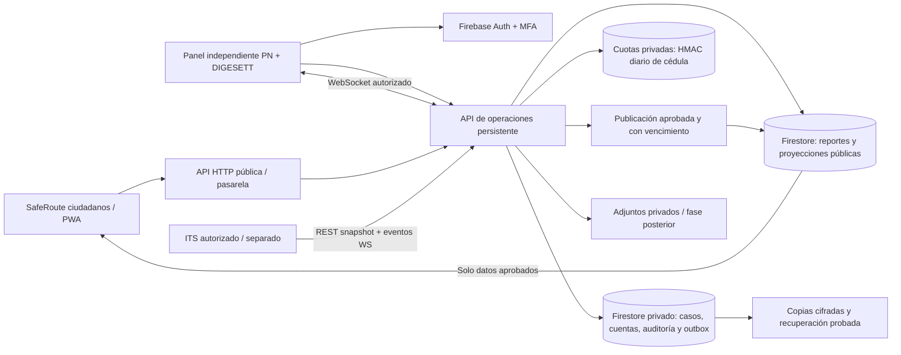

# Piloto conjunto Policía Nacional y DIGESETT — Fase 1: diseño

Estado: diseño completado con prototipo interactivo en `/piloto/`. El prototipo no habilita cuentas oficiales, no conecta sistemas de las instituciones y no convierte la demostración ITS en vigilancia real. La autenticación y la operación institucional pertenecen a las fases siguientes.

## Alcance acordado y decisiones pendientes

El usuario solicita un panel independiente para que Policía Nacional y DIGESETT gestionen tránsito y reportes ciudadanos y preparen avisos digitales para quienes usan SafeRoute. Se recomienda una aplicación separada con API compartida; la separación visual no sustituye los permisos del servidor.

Supuestos de dimensionamiento, todavía no confirmados: Santo Domingo; 10 operadores concurrentes; 100 reportes/día; un único servicio persistente de operaciones para el piloto. No son capacidades medidas ni límites institucionales. Los polígonos de operación y acuerdos entre instituciones deben ser proporcionados y aprobados por sus responsables; un mapa de Santo Domingo no acredita jurisdicción.

Pendientes críticos antes del MVP con datos reales:

- Responsable que autoriza altas, bajas, roles, zonas y el uso del nombre de cada institución. Actualmente no está definido.
- Presupuesto, cuenta propietaria del alojamiento, región de datos y condiciones de los proveedores. Actualmente no están definidos.
- Responsable del tratamiento, base jurídica, aviso de privacidad, plazos de conservación y procedimiento para derechos de los ciudadanos. Deben confirmarse para República Dominicana; este diseño no acredita cumplimiento legal.
- Operadores y supervisores reales que revisarán incidentes y aprobarán comunicaciones, horarios y escalamiento. Un piloto técnico no sustituye la recepción de emergencias ni el despacho institucional.
- Cámaras/streams autorizados y su calibración. Hoy no se acredita acceso a cámaras institucionales.

La preferencia confirmada para reportar sin cuenta es usar una **huella protegida de la cédula**, sin conservar el número completo. La huella limita repetición; no prueba identidad ni autoría. No se consultará una supuesta API de la JCE ni se verificará titularidad sin un servicio y autorización reales.

## Lo que ya existe en el repositorio

Comprobado mediante lectura de código y dependencias locales:

| Componente | Evidencia actual | Consecuencia para el piloto |
|---|---|---|
| Ciudadanos | React 19.3.0, Vite 8.3.4, Leaflet 1.9.4; `src/App.jsx`, `src/navigation.js` | Reutilizar estilo y mapa; desplegar el panel por separado |
| Identidad | Firebase JS 13.0.0; `src/store.js` | Correo/contraseña y envío anónimo; no hay roles institucionales ni MFA de autoridades implementados |
| Reportes | Firestore, colección `reports`; `firestore.rules` | Ocho campos públicos fijos; lectura solo de aprobados; creación pendiente y cuota por UID |
| API web | Firebase Admin 14.5.0, funciones Node en `api/`, `vercel.json` | Reutilizar verificación de tokens y patrones de servidor; la cédula no debe ir en el documento público |
| ITS | Python 3.12+, FastAPI 0.162.0; `traffic-its/src/traffic_its/api.py` | REST `/v1/snapshot`, eventos con cursor y WebSocket `/v1/stream` ya tienen código |
| ITS mostrado a ciudadanos | `api/its.js` → `safeorute-its-demo.onrender.com` | Pasarela actual solo acepta datos sintéticos; no debe abrirse silenciosamente a datos reales |
| Alojamiento ITS | `render.yaml`: demostración pública, lectura, `autoDeploy: false` | No usar ese despliegue como backend privado de las autoridades |

La moderación actual de Firebase se realiza desde consola; la pestaña de moderación de la app es una simulación local. El prototipo incorpora una bandeja de prueba; todavía no existe una bandeja institucional autenticada, publicación oficial ni respuesta privada a reporteros en producción.

## Prototipo visual terminado

Abre `/piloto/` en el despliegue o ejecuta `npm run dev` y visita esa ruta. Tiene una entrada HTML y un paquete de interfaz propios; la aplicación ciudadana conserva su entrada `/`. Compartir alojamiento para esta maqueta facilita su revisión. El panel operativo futuro se desplegará en un origen independiente con la API y autenticación previstas en este diseño.

Recorridos disponibles:

1. **Resumen:** indicadores que filtran la bandeja y un esquema ilustrativo de Santo Domingo con ubicaciones ficticias seleccionables. No es cartografía para navegación.
2. **Reportes:** búsqueda, filtros, estados, asignación y notas de prueba. El detalle separa Observado, Causa probable, confianza y su criterio. Los perfiles muestran la vista de cada institución.
3. **Avisos:** crear un borrador como operador, enviarlo a revisión, cambiar a otro perfil supervisor, aprobar su versión y publicarla en la vista ciudadana simulada. Retirar un aviso exige motivo; editar invalida su aprobación anterior.
4. **Cámaras:** ejemplos de congestión y estado, incluida una cámara sin señal con velocidad desconocida. No hay video ni cámaras conectadas.
5. **Historial:** acciones de la simulación y reinicio de los datos de prueba.

El selector **Perfil de demostración** muestra vistas y reglas de flujo; no constituye login, MFA ni una frontera de seguridad. El estado vive en memoria y se reinicia al recargar. No llama a una API, no escribe en Firestore, no guarda notas en el navegador, no envía avisos a ciudadanos y no solicita cédulas ni credenciales. Los permisos institucionales reales deben implementarse y validarse en el servidor durante la fase operativa.

El prototipo no instala el manifest ciudadano ni se guarda en la caché de navegación de su PWA. La ruta `/piloto/` queda fuera del fallback ciudadano para que el enlace abra su propia entrada.

## Arquitectura elegida

| Opción | Ventaja | Coste o riesgo | Decisión |
|---|---|---|---|
| Panel independiente + API compartida | Una fuente de reportes; reglas uniformes; pocos cambios en la app pública | La API requiere autorización rigurosa y una migración controlada | Recomendada para este piloto |
| Microservicios de reportes, comunicaciones y auditoría | Escalado y despliegues por dominio | Más colas, contratos, duplicación y recuperación distribuida | Posponer hasta que las mediciones lo justifiquen |

El motor de visión ITS sigue separado porque procesa video y tiene requisitos distintos. El backend de operaciones será inicialmente un monolito modular, no un conjunto de nuevos microservicios. Su API y su WebSocket requieren un proceso persistente; las funciones existentes de Vercel seguirán atendiendo solicitudes HTTP cortas. El frontend del panel puede alojarse como sitio estático independiente.



Estructura prevista para la aplicación operativa; `apps/authorities/` ya contiene el prototipo visual:

```text
apps/authorities/              # React: acceso, bandeja, caso, mapa, avisos
services/operations/
  auth/                       # tokens, MFA, membresías, zonas y revocación
  reports/                    # ingreso, estados y control de concurrencia
  notices/                    # borrador, aprobación, publicación y retractación
  its/                        # adaptador REST/WS y frescura de mediciones
  events/                     # outbox durable, cursores y recuperación
  audit/                      # acciones y lecturas privadas
  storage/                    # Firestore, adjuntos y exportación
  tests/                      # permisos, contratos, recuperación y carga
api/                          # pasarelas web existentes; migración gradual
docs/autoridades/             # diseño y decisiones revisables
```

## Identidad, roles y jurisdicción

Las cuentas de autoridades serán invitadas por un administrador autorizado. No habrá autorregistro institucional ni permisos derivados del dominio de un correo. El servidor comprobará token, revocación, MFA, membresía activa, institución y zonas en cada solicitud. Los permisos del cliente solo sirven para presentar la interfaz.

| Rol | Facultades | Restricción principal |
|---|---|---|
| Administrador | Gestionar miembros, zonas, configuración y revocación | No obtiene por ese rol permiso para aprobar avisos |
| Supervisor | Verificar casos, priorizar, reasignar y aprobar/retractar avisos | No aprobar su propio borrador |
| Operador | Revisar casos, actualizar atención, añadir notas y proponer avisos | Solo sus instituciones/zonas; no publicar directamente |
| Solo lectura | Consultar casos y métricas permitidos | Sin mutaciones ni identidad del ciudadano |
| Institución externa | Casos y documentos explícitamente compartidos | Sin acceso general a PN/DIGESETT |

Los roles pueden combinarse mediante concesiones explícitas; no hay jerarquía implícita que eluda la doble revisión. Compartir un caso entre PN y DIGESETT exige una concesión registrada. Sin zonas concedidas, el resultado es denegado, no acceso a todo el país. La asignación digital no confirma que una patrulla o agente haya recibido una orden.

MFA propuesto: TOTP mediante Firebase Authentication con Identity Platform. Se comprobó que las APIs del SDK existen, pero **deben confirmarse la habilitación, condiciones, facturación y disponibilidad en la cuenta**. Si el proveedor no permite MFA real, no se abre el piloto institucional a datos reales. La aprobación/publicación requerirá autenticación reciente, inicialmente ≤15 minutos, y un segundo factor comprobado por el servidor. Recuperación de MFA y alta del primer administrador necesitan un procedimiento documentado entre responsables, no un botón público.

## Esquema de datos y separación pública/privada

Firestore no permite ocultar campos dentro de un documento que el lector ya puede leer. Por eso las notas, las membresías y los identificadores nunca se añadirán al documento público de un reporte.

| Colección propuesta o existente | Campos principales | Acceso |
|---|---|---|
| `reports/{id}` existente | `category`, `description`, `lat`, `lng`, `occurredAt`, `status`, `source`, `createdAt` | Ciudadanos: solo `approved`; escritura bajo contrato vigente/migración |
| `operationsCases/{id}` nueva | `reportId`, `workflowState`, `priority`, `zoneId`, `institutions`, `assignedTo`, `version`, marcas temporales | Solo API autorizada |
| `operationsCases/{id}/notes/{noteId}` nueva | autor interno, texto, fecha, clasificación y versión | Solo roles del caso; no proyección pública |
| `authorityMemberships/{uid}` nueva | estado, instituciones, roles, zonas y versión de permisos | Solo API administrativa |
| `noticeDrafts/{id}` nueva | autor, evidencia, texto, zona/geometría, vigencia, revisión, versión | Privada hasta aprobación |
| `publicNotices/{id}` nueva | título/texto aprobado, institución, zona/geometría, vigencia, estado, versión pública | Solo lectura pública; sin UID privado del autor |
| `reportOwners/{reportId}` futura | UID del remitente y permisos de conversación | Privada; no HMAC ni número de cédula |
| `conversations/{id}/messages/{id}` futura | caso, remitente autorizado, texto y recibo | API comprueba propietario o rol del caso |
| `guestIdentityLimits/{dayFingerprint}` privada del piloto | día, contador, último envío, vencimiento | Servidor; sin número completo ni enlace permanente al reporte |
| `operationsEvents/{sequence}` nueva | tipo, entidad, versión, destinatarios/zonas y fecha | Outbox privado; se proyecta según el consumidor |
| `auditEvents/{id}` nueva | actor, acción, objeto, resultado, motivo y fecha | Escritura del servidor; consulta restringida |

`workflowState` admite `new`, `reviewing`, `verified`, `assigned`, `in_progress`, `resolved`, `discarded`. No se reutiliza el `status` público para esos estados: verificar un incidente para gestión no lo publica automáticamente. Cada cambio define transición, motivo, permiso y versión esperada. Los duplicados se vinculan a un caso principal; no se borran sus evidencias ni se tratan como prueba de que el hecho es verdadero.

Las coordenadas de reportes ciudadanos siguen siendo aproximadas; el panel no recuperará precisión que nunca se recopiló. Cierres oficiales pueden usar un tramo o polígono autorizado, sin publicar direcciones particulares. Los adjuntos serán privados, con tamaño/tipo limitados, análisis antes de servir y URLs breves autorizadas; no habrá subida de fotografías de cédulas como sustituto de verificación.

### Cédula para el ingreso sin cuenta

El flujo previsto en la app pública es un endpoint de servidor `/api/reports`, con descubrimiento de capacidades/configuración antes de exigir el nuevo paso. La implementación pública se activa por configuración del servidor y política privada, no simplemente por mostrar un campo. No se afirma aquí que esté desplegada.

1. El usuario ve finalidad, plazo y responsable; introduce la cédula solo si el flujo de ingreso configurado la exige.
2. El servidor comprueba formato normalizado de 11 dígitos. Esa comprobación no consulta un registro civil ni acredita titularidad.
3. Produce HMAC-SHA-256 con secreto exclusivo del servidor, día y espacio de nombres. No usar SHA-256 simple: el dominio de números posibles permite enumeración.
4. Aplica cuota privada por huella diaria y por sesión, además de límites globales de abuso. Una cédula escrita por otra persona sigue siendo posible; no llamar al resultado «identidad verificada».
5. Guarda el reporte con sus ocho campos públicos habituales y la cuota privada; no persiste el número completo, no lo devuelve, no lo usa como UID y no lo incluye en URL, analítica ni logs.

La huella diaria sigue siendo un dato seudonimizado y necesita protección y retención. El secreto `REPORT_ID_HMAC_KEY` o su equivalente nunca lleva prefijo `VITE_`. Rotación, versión y eliminación de contadores deben probarse. No se crea un historial estable entre días ni un vínculo público entre cédula y reportes. La opción para demostrar reportes localmente no debe fingir que valida cédulas ni enviar números a una API de prueba.

El cierre de la vía antigua de escritura debe coordinarse con reglas, clientes instalados y disponibilidad del endpoint. Dejar escrituras anónimas directas abiertas permite omitir la nueva política; cambiar las reglas antes de que el backend esté listo bloquearía reportes legítimos. La fase de activación documentará ese corte y su reversión.

## Contrato REST propuesto

Estos endpoints de operaciones son contratos de diseño; no se presentan como rutas ya implementadas. Los existentes de ITS conservan su propio contrato. JSON con validación estricta, tamaño máximo, fechas UTC, identificadores opacos e `Idempotency-Key` en creaciones; paginación por cursor, nunca descarga ilimitada.

| Método y ruta | Finalidad | Permiso |
|---|---|---|
| `GET /v1/authority/me` | Membresía y capacidades efectivas | Autoridad con MFA |
| `GET /v1/authority/cases?state=&zone=&cursor=` | Bandeja filtrada por concesiones del servidor | Lectura del caso |
| `GET /v1/authority/cases/{id}` | Caso y evidencia autorizada; auditar lectura | Lectura del caso |
| `PATCH /v1/authority/cases/{id}` | Cambiar estado/prioridad/asignación con `expectedVersion` | Operador o supervisor según transición |
| `POST /v1/authority/cases/{id}/notes` | Nota interna | Operador del caso |
| `GET /v1/authority/traffic/snapshot` | Estado ITS y frescura de las cámaras autorizadas | Lectura por zona |
| `POST /v1/authority/notices` | Crear borrador oficial | Operador autorizado |
| `POST /v1/authority/notices/{id}/submit` | Solicitar revisión | Autor del borrador |
| `POST /v1/authority/notices/{id}/approve` | Aprobar versión exacta y publicarla | Supervisor distinto del autor |
| `POST /v1/authority/notices/{id}/retract` | Retirar aviso manteniendo corrección pública | Supervisor; motivo obligatorio |
| `GET /v1/public/notices?bbox=&cursor=` | Avisos aprobados y vigentes | Público; respuesta por proyección explícita |
| `POST /v1/authority/ws-ticket` | Ticket de uso único, 30 s, ligado a UID/origen | Autoridad con MFA |
| `GET /v1/authority/events?after=&limit=` | Recuperación de eventos permitidos | Autoridad con MFA |
| `POST /v1/authority/cases/{id}/reply` | Responder al remitente del caso | Fase 4; relación privada de propietario |
| `GET /v1/authority/statistics?...` | Agregados y exportaciones acotadas | Fase 5; permiso de estadísticas |

Ejemplo de cambio con control de concurrencia:

```http
PATCH /v1/authority/cases/case_example
Authorization: Bearer <ID_TOKEN>
Content-Type: application/json

{"expectedVersion":3,"workflowState":"assigned","institution":"DIGESETT","assignedTo":"operator_example","reason":"Revisión de obstrucción reportada"}
```

```json
{"id":"case_example","version":4,"workflowState":"assigned","eventCursor":"1042"}
```

Una versión ya modificada devuelve `409`; permiso ausente, `403`; sesión/MFA ausente, `401`; cuota, `429`. Un identificador de caso no otorga acceso. La API comprueba la institución destino y la zona, no acepta como autorización los valores del cuerpo. Los errores no revelan cédulas ni existencia de casos privados a personas sin acceso.

Ejemplo de borrador de aviso, nunca publicado directamente por este POST:

```json
{"kind":"lane_closure","zoneId":"pilot_zone_example","title":"Cierre parcial de carril","observed":["Operador registra un carril bloqueado a las 14:05"],"probableCause":"Obra reportada, pendiente de corroborar","confidence":"low","recommendation":"Reducir velocidad y respetar las indicaciones en el lugar","validFrom":"2026-11-03T14:05:00Z","expiresAt":"2026-11-03T15:05:00Z","evidenceRefs":["case_example"],"expectedVersion":1}
```

Los identificadores, hechos y horas de este ejemplo son ficticios. Un supervisor debe revisar evidencia, alcance, vigencia y versión antes de aprobar.

## Tiempo real, cámaras y comunicaciones

Cada transacción de negocio confirmará conjuntamente estado, auditoría de mutación y evento de outbox en Firestore. No se envía primero por WebSocket y luego se intenta guardar. Un contador secuencial transaccional basta para el piloto; si presenta contención, se medirá antes de particionar. El consumidor conserva cursor; deduplica por evento/versión y acepta entrega al menos una vez.

WebSocket del panel: `wss://<operations-host>/v1/authority/stream`. La primera trama transporta el ticket de uso único; no va en la URL ni contiene credenciales permanentes. El servidor valida origen exacto, consume ticket, aplica permisos y emite `ready`, eventos y heartbeat. Al vencer credenciales, revocar roles o cambiar zonas, cierra la sesión o exige reautenticación; objetivo de revocación ≤30 s. Cursores se filtran por permisos actuales; nunca se comparte un evento interno por haber sido visible en el pasado. Cursor eliminado devuelve `resync_required` y se solicita snapshot.

El adaptador ITS usa snapshot inicial y `/v1/stream`, con `/v1/events` para recuperación. El servicio ITS actual autentica el token en la primera trama y rechaza `token` en la URL: mantener ese contrato y los secretos solo entre servidores. No reenviar credenciales Firebase al ITS. Tras caídas, conservar el último dato con su hora y marcarlo vencido; no interpretar falta de señal como cero vehículos, congestión detenida o recuperación.

El frontend ciudadano seguirá leyendo solo reportes aprobados y, en fase 4, la colección pública de avisos aprobados mediante API o suscripción limitada. `onSnapshot` ya existe para reportes; una suscripción pública de avisos debe tener reglas y proyección propias. No es necesario dar a ciudadanos acceso al WebSocket institucional. No mezclar eventos sintéticos con avisos oficiales; la demo conserva etiqueta de demostración y no activa publicaciones reales.

Todos los avisos separan **Observado**, **Causa probable**, fuente, hora, vigencia y recomendación. Confianza es una clasificación explicable, no una probabilidad:

- **Bajo**: una señal o reporte sin corroboración, datos vencidos o calidad insuficiente. Mostrar incertidumbre; no afirmar accidente/avería.
- **Medio**: observaciones persistentes y consistentes, con evidencia parcial de la causa; requiere revisión del supervisor.
- **Alto**: evidencia vigente corroborada por fuentes independientes o verificación documentada de un responsable autorizado. No equivale a certeza ni se deduce solo de velocidad baja.

La congestión observada puede ser real aunque su causa siga sin determinarse. El piloto no promete detectar automáticamente accidentes, semáforos averiados, lluvia u obras si no existe evidencia correspondiente. Reglas de visión y datos GPS se validan por separado antes de elevar confianza.

Flujo de avisos: `draft → submitted → approved/published → expired` o `retracted`. Cualquier cambio de texto, geometría o vigencia invalida la aprobación anterior; publicar exige la versión aprobada dentro de la misma transacción. La retractación deja una corrección pública y una auditoría; no se borra silenciosamente el aviso. Los avisos masivos pasan por la misma aprobación. En pantalla y sonido opcional tras una interacción del operador; agrupar por zona/caso, limitar repeticiones y conservar prioridad. Correo/SMS/WhatsApp quedan fuera del piloto inicial y requieren proveedor, consentimiento, coste y confirmación de entrega.

Responder a un ciudadano requiere registrar de forma privada el UID que ingresó el reporte. Los reportes actuales no tienen esa relación y no pueden vincularse retrospectivamente a una persona a partir del texto o de la cédula. Una sesión anónima perdida puede perder acceso a su conversación; no prometer mensajes entre dispositivos sin una cuenta o mecanismo de recuperación diseñado.

## Seguridad, conservación y recuperación

- HTTPS; orígenes explícitos; token verificado por Firebase Admin con comprobación de revocación; MFA y membresía autoritativa en servidor. Revalidar al usar el canal, no confiar solo en el login.
- JSON y campos permitidos; límites de longitud/tamaño; texto mediante nodos de texto de React, sin HTML arbitrario. Exportaciones CSV neutralizan fórmulas; adjuntos no se sirven como HTML/SVG activo.
- No usar cookies de autoridad en endpoints públicos. Si se eligen cookies HttpOnly para la sesión institucional, añadir SameSite, validación Origin y protección CSRF explícita; una decisión de transporte no elimina el riesgo XSS.
- Cuotas por UID, huella diaria y global; expiración e idempotencia; no permitir que un reinicio de proceso reinicie contadores. El código cliente no decide si una publicación está autorizada.
- Auditoría de lecturas privadas, exportaciones, altas/bajas, cambios, denegaciones y publicaciones; registrar actor/objeto/acción, no cuerpos completos, cédulas ni tokens. Acceso a auditoría también se audita. Una consulta general debe acotarse y no ser una vía de extracción masiva.
- Credenciales solo en servidor; cuentas de servicio distintas para demo y operaciones; privilegios mínimos. Los SDK Admin eluden las reglas Firestore: todas las comprobaciones del backend son obligatorias.
- Desactivar caché de API y documentos privados. El service worker del panel, si se agrega, no guardará expedientes ni credenciales para operación offline. Una acción pendiente no se muestra como enviada sin confirmación del servidor.

Referencias de revisión: OWASP ASVS y OWASP API Security Top 10 para autorización por objeto/función, inyección, sesiones, exposición de datos y límites de recursos. Su documentación oficial no se revisó en línea en esta fase; no se declara certificación ni una auditoría realizada. Antes de datos reales, revisar permisos entre instituciones, recuperación de MFA, fuga en logs/exportaciones, secretos, dependencias, adjuntos y pruebas de abuso.

Retención propuesta, pendiente de aprobación: métricas/casos de piloto 90 días; avisos y auditoría 1 año; cuotas HMAC con vencimiento al inicio del segundo día UTC siguiente, sujeto a borrado TTL asíncrono; adjuntos 30 días tras cierre salvo conservación justificada. Esos plazos son decisiones iniciales, no obligaciones legales verificadas. La eliminación debe cubrir índices, eventos exportables y copias según el calendario acordado; registros agregados no incluirán identificadores de ciudadanos.

Respaldo: exportación cifrada diaria a almacenamiento separado con acceso limitado; retención inicial de copias 30 días; secretos fuera del respaldo de datos, con recuperación independiente. Deben confirmarse disponibilidad, facturación, región y alcance de exportación Firestore. Objetivos estimados del piloto: RPO ≤24 h y RTO ≤4 h. Una caída de una instancia no debe perder transacciones confirmadas porque no dependen del disco local. Probar restauración mensual en un proyecto aislado, reconstruir proyecciones/outbox y comprobar que un restore no publique de nuevo avisos vencidos ni revierta revocaciones de cuentas sin revisión.

## Stack y estado de verificación

Fecha de revisión del repositorio: 2 de noviembre de 2026, hora del usuario. Versiones observadas en el entorno, no una afirmación sobre la versión del despliegue público.

| Pieza propuesta | Versión de referencia | Qué se comprobó | Qué falta confirmar |
|---|---|---|---|
| React / React DOM / Vite | 19.3.0 / 19.3.0 / 8.3.4 | Instalados y usados en el repo | Nuevo build independiente del panel |
| Leaflet | 1.9.4 | Instalado; mapas actuales | Licencia, cuota y claves Geoapify para operadores |
| Firebase JS | 13.0.0 | SDK instalado; `onSnapshot`; TOTP en tipos locales y fuente oficial | Habilitación Identity Platform/MFA, facturación y configuración real |
| Firebase Admin Node | 14.5.0 | Instalado; verificación de token en APIs; tipos oficiales de segundo factor | IAM, proyecto de operaciones y secretos de producción |
| Node.js | 24.19.0 observado | Ejecutable local y APIs HTTP/crypto existentes | Imagen fijada, mantenimiento y configuración del nuevo servicio |
| `ws` | 8.22.1 como candidato | `package.json` y README oficiales consultados; `WebSocketServer`, `noServer`, `handleUpgrade` existen | No está añadido como dependencia de operaciones; fijar release, integridad y ejecutar pruebas en fase 2/3 |
| FastAPI / ITS | 0.162.0 | Pin en `traffic-its/pyproject.toml`, rutas REST y WS leídas | Validación de cámaras reales y despliegue privado autorizado |
| Firestore transacciones/suscripciones | Servicio, sin número de versión único | SDKs y transacciones ya usados en repo | Índices, reglas privadas/públicas, cuotas, exportación y residencia |
| Playwright / Node test runner | 1.64.1 / Node 24.19.0 | Herramientas existentes del repo | Suite nueva institucional; lo aprobado de la app pública no valida el panel futuro |

Fuentes oficiales efectivamente leídas: [README de ws](https://github.com/websockets/ws/blob/master/README.md), [package.json de ws](https://github.com/websockets/ws/blob/master/package.json), [TOTP en Firebase JS](https://github.com/firebase/firebase-js-sdk/blob/main/packages/auth/src/mfa/assertions/totp.ts), [tipos de token de Firebase Admin](https://github.com/firebase/firebase-admin-node/blob/master/src/auth/token-verifier.ts). Las ramas principales son mutables: fijar tag/commit y comprobar publicación antes de añadir una dependencia.

Intentos de documentación oficial de proveedor bloqueados por el proxy del entorno con HTTP 403: [Firebase TOTP MFA](https://firebase.google.com/docs/auth/web/totp-mfa), [verificación de tokens](https://firebase.google.com/docs/auth/admin/verify-id-tokens), [límites de funciones Vercel](https://vercel.com/docs/functions/limitations). Se comprobó código oficial accesible, pero no se verificaron en esa documentación contratos comerciales, disponibilidad o precios. No se inventa una tarifa ni una API institucional.

## Dimensionamiento y criterios de aceptación

Inicio propuesto: backend persistente 1 vCPU/1–2 GB RAM, una instancia; frontend estático; Firestore existente o proyecto aislado para pruebas. Es una estimación para formularios, eventos y 10 operadores, no para inferencia de cámaras ni archivos pesados. La visión ITS necesita su propio dimensionamiento. No exigir Redis ni GPU al panel. Un nivel de alojamiento que duerme puede servir para demostración, pero no cumple atención continua ni latencias operativas.

No hay presupuesto aprobado. Estimar coste como instancia persistente + lecturas/escrituras/almacenamiento Firestore + MFA/identidad + mapas + copias + egreso. Antes del MVP medir una jornada sintética, limitar la tasa de sondeo, poner alarmas de gasto y cotizar planes vigentes; no asumir que los planes gratuitos cubren este piloto institucional.

Metas iniciales de aceptación, **estimadas y no medidas en un panel todavía inexistente**:

| Prueba | Meta y evidencia exigida |
|---|---|
| Autorización | 0 documentos/campos de otros roles, zonas o instituciones en una matriz completa de pruebas negativas, incluidos REST, WS y exportación |
| MFA y revocación | 100% de sesiones institucionales sin segundo factor rechazadas; revocación bloquea REST y WS en ≤30 s |
| Publicación | 0 avisos públicos sin supervisor distinto del autor y versión aprobada; carrera entre editar/aprobar/retractar se resuelve transaccionalmente |
| Confidencialidad de cédula | 0 números completos en documentos, logs, URLs, respuestas, analítica y exportaciones; pruebas con marcadores sintéticos verifican la ausencia |
| Reportes/latencia | Con 10 operadores y ráfaga sintética de 20 reportes/min, p95 de crear/actualizar ≤1 s excluyendo red cliente/proveedor; medir por separado extremo a extremo |
| Tiempo real | p95 de publicación confirmada a panel conectado ≤2 s; reconexión conserva todos los cambios confirmados por cursor o resync |
| Cámaras | Datos vencidos se identifican en ≤15 s según política de frescura; una desconexión nunca genera una medición de cero ni una causa confirmada |
| Persistencia | Reiniciar backend entre confirmar y enviar evento no pierde el evento; reenvío no duplica avisos ni notas |
| Usabilidad | Flujos principales sin desplazamiento horizontal en 390, 768 y 1366 px; teclado y foco operables; estado y error comprensibles sin depender del color |
| Recuperación | Restauración aislada demostrada dentro de RTO/RPO propuestos; avisos vencidos y permisos revocados no reaparecen activos |

Casos obligatorios: operador intenta aprobar su propio aviso; UID inactivo conserva token antiguo; operador PN sin concesión intenta ver caso DIGESETT; un segundo supervisor edita mientras otro aprueba; texto de aviso contiene HTML; CSV empieza con fórmula; ciudadano solicita notas internas; stream se cae y reconecta; cursor caduca; evento llega dos veces; ITS sintético intenta originar aviso oficial; reporte ciudadano llega sin cuenta; huella diaria supera cuota; mismo número cambia de día; backend sin clave HMAC rechaza el modo obligatorio sin guardar datos; restaura una copia con aviso ya retractado; usuario anónimo pierde su sesión y no puede leer conversaciones ajenas.

La revisión profesional de seguridad y la confirmación jurídica son condiciones de salida a datos reales, no una promesa de seguridad absoluta. No se afirma precisión de clasificación de causas: debe validarse con evidencia etiquetada y reportarse por causa, condiciones y número de casos antes de usarla para publicación automática.

## Entrega por fases y siguiente decisión

1. **Fase 1, este documento y `/piloto/`:** arquitectura, permisos, contratos, separación de datos, metas, preguntas pendientes y prototipo visual navegable. No se han creado cuentas institucionales ni conectado datos reales.
2. **Fase 2, tras aprobación:** entorno de prueba aislado, login con MFA/roles, bandeja, estados, mapa y pruebas de autorización. Usar datos sintéticos hasta designar responsables y confirmar proveedores.
3. **Fase 3, tras aprobación:** outbox/WS, recuperación, fuentes ITS autorizadas y frescura; mantener demo claramente separada de producción.
4. **Fase 4, tras aprobación:** avisos con doble revisión, publicación/retractación, respuestas privadas y plantillas; ampliar app ciudadana con sus reglas públicas.
5. **Fase 5, tras aprobación:** estadísticas, CSV/PDF, auditoría completa, carga, respaldo/restauración y revisión de seguridad para salida operativa.

Para aprobar la fase 2 faltan confirmar los supuestos de zona/volumen, responsable de cuentas y datos, presupuesto/proveedores y la decisión de iniciar con datos sintéticos. Aprobar el diseño no equivale a autorizar comunicaciones oficiales reales ni acceso a cámaras de las instituciones.
