# Fase 2 — MVP funcional de una cámara

Fecha: 30 de octubre de 2026. Código: [traffic-its/](../../traffic-its/). Este entregable implementa el piloto de una cámara del [diseño de la Fase 1](FASE_1_DISENO.md). Tiene procesamiento Python, persistencia, REST, WebSocket y dashboard; todavía no demuestra precisión o disponibilidad en una vía real.

La demostración es **sintética**: genera vehículos, tiempos y una geometría conocida. Sus 30 km/h sirven para comprobar el recorrido del software. No son mediciones de Santo Domingo ni resultados de detección sobre imágenes reales. La ubicación del mapa es ilustrativa y está rotulada en la configuración.

## Alcance implementado

| Parte | Comportamiento del MVP |
|---|---|
| Fuente | Escena sintética declarada, archivo autorizado o RTSP/IP autorizado; una fuente real fallida nunca se reemplaza por simulación |
| Detección real | YOLOX Nano ONNX, CPU, cuatro clases COCO: carro, moto, guagua/bus y camión |
| Seguimiento | ByteTrack de Supervision; asociaciones e identificadores de vehículos solo en RAM |
| Aforo | Cruces orientados de líneas finitas dentro del carril, histéresis y deduplicación por track/línea/época |
| Velocidad | Homografía con controles independientes, tiempo del medio y ajuste longitudinal robusto; no disponible si falta soporte válido |
| Congestión | Fluido, moderado, denso, detenido o desconocido; referencia de flujo libre declarada y visible como no validada cuando corresponde |
| Salud | Ausencia de frames, congelación sospechada, baja calidad y posible cambio de encuadre; no diagnostica una avería física |
| Alertas | Salud de cámara y congestión observada persistente; hechos y causa probable separados, causa no determinada de confianza baja |
| Distribución | REST, WebSocket con recuperación por cursor y dashboard móvil de metadatos |
| Histórico | SQLite local o PostgreSQL; ventanas agregadas, estados, alertas, revisiones y log durable |

La publicación de causas al público permanece deshabilitada, incluso tras una revisión manual. Escalado multicámara, GPS/fusión, diagnóstico de las ocho causas e integración visual en la aplicación SafeRoute corresponden a fases posteriores. Exponer estos contratos no instala un servidor persistente en Vercel.

## Arquitectura que ejecuta este piloto

```mermaid
flowchart LR
    Source[Fuente autorizada o demo explícita] --> Ingest[PyAV / generador sintético]
    Ingest --> Buffer[Buffer reciente acotado]
    Buffer --> Health[Salud y calidad]
    Buffer --> Detect[YOLOX Nano o detector sintético]
    Detect --> Track[ByteTrack en RAM]
    Track --> Metrics[Homografía, velocidad y aforo]
    Health --> Metrics
    Metrics --> Rules[Alertas de observaciones]
    Metrics --> DB[(Metadatos y outbox)]
    Rules --> DB
    DB --> Relay[Relay del log durable]
    Relay --> Events[(Eventos ordenados)]
    DB --> API[FastAPI REST]
    Events --> WS[WebSocket con cursor]
    API --> UI[Dashboard móvil]
    WS --> UI
```



El proceso HTTP no abre cámaras ni ejecuta inferencia. El trabajador de cámara, el relay y la API pueden reiniciarse por separado. La demo local los inicia juntos para facilitar la revisión; Docker Compose los separa en servicios.

Dos decisiones concretan el diseño original:

1. La persistencia usa **SQLAlchemy síncrono**, ejecutado con `asyncio.to_thread` desde FastAPI. No se necesita el extra `asyncio` de SQLAlchemy en este baseline.
2. La notificación usa **polling de un log durable**, no depende de `LISTEN/NOTIFY`. El relay asigna la secuencia después de confirmar la transacción productora. Estado y outbox se guardan juntos; dos relays no deben duplicar el evento confirmado.

El bloqueo del contador de entrega también hace coherente la pareja snapshot/cursor. Un lease con token de cercado impide que dos trabajadores activos escriban a la vez para la misma cámara. Es una protección funcional del piloto, no un benchmark de escalado multicámara.

## Archivos y responsabilidad

```text
traffic-its/
├── configs/                 # demo.json, file.json y rtsp.json
├── models/manifest.json     # Fuente, versión, tamaño y hash del ONNX
├── src/traffic_its/
│   ├── config.py            # JSON tipado, geometría y controles de capacidades
│   ├── domain.py            # Frame, detección y observación de track
│   ├── ingest.py            # PTS, reconexión y buffer reciente
│   ├── vision.py            # YOLOX, ByteTrack y fixtures sintéticos separados
│   ├── health.py            # Calidad, falta de señal y encuadre
│   ├── analytics.py         # Calibración, velocidad, aforo y ventanas
│   ├── worker.py            # Pipeline de una cámara y alertas de observación
│   ├── store.py             # Tablas, transacciones, leases y log durable
│   ├── api.py               # REST, autenticación y WebSocket
│   ├── cli.py               # demo, api, worker, relay, doctor y esquema
│   └── static/              # Dashboard y Leaflet servido localmente
├── tests/                   # Pruebas de contratos, fallas y pipeline
├── tests-dashboard/         # Playwright Chromium
├── deployment/              # Overrides de archivo/RTSP y esquema SQL
├── Dockerfile
├── compose.yaml
├── pyproject.toml
├── requirements.lock        # Runtime con versiones y hashes
└── requirements-dev.lock    # Runtime y pruebas con versiones y hashes
```

Los videos de entrada, pesos ONNX, entornos virtuales, bases locales y archivos privados `.env*` quedan fuera del repositorio. El ejemplo `.env.example` puede versionarse. La guía de ejecución completa está en [traffic-its/README.md](../../traffic-its/README.md).

## Ejecución reproducible

Desde `traffic-its/`, con Python 3.12 y [uv](https://docs.astral.sh/uv/):

```bash
uv venv .venv --python python3.12
uv pip install --python .venv/bin/python --require-hashes -r requirements-dev.lock
uv pip install --python .venv/bin/python --no-deps -e .
.venv/bin/python -m traffic_its.cli demo --host 127.0.0.1 --port 8000
```

Abre `http://127.0.0.1:8000/`. El dashboard rotula la simulación y muestra salud, velocidad sintética, aforo por carril, histórico y alertas. La base SQLite se crea en `data/`. La demo no necesita pesos del detector real. Ctrl+C detiene sus procesos.

Para Docker Compose con PostgreSQL:

```bash
python scripts/init_local_env.py
docker compose up --build
```

El script genera credenciales aleatorias sin imprimirlas y conserva un `.env` existente. Solo la API publica un puerto, asociado a `127.0.0.1` de forma predeterminada. La base queda en la red interna; los procesos de aplicación usan un usuario sin privilegios y raíz de solo lectura. `docker compose down` conserva el volumen histórico.

Los límites iniciales del trabajador en Compose son 4 CPU y 4 GiB, configurables; API, relay y PostgreSQL tienen sus propios límites. Son asignaciones de arranque, **no capacidad medida**. Resolución, codec, densidad vehicular y CPU de destino deben perfilarse con la fuente real antes de dimensionar otras cámaras.

Para una fuente real, descarga el modelo fijado y consulta el apartado de archivo o RTSP de la guía:

```bash
.venv/bin/python -m traffic_its.cli download-model --output models/yolox_nano.onnx
.venv/bin/python -m traffic_its.cli doctor --model models/yolox_nano.onnx
```

Los ejemplos `file.json` y `rtsp.json` comienzan sin calibración y sin aforo habilitado. No devuelven km/h o conteos por carril válidos hasta completar su configuración. La URI real se obtiene de una variable de entorno; no se devuelve en REST ni se conserva en histórico. Un archivo termina como `replay_finished`, sin presentarse como tráfico vivo.

## Relojes, calibración y significado de los valores

La velocidad usa `frame.pts × frame.time_base`, no FPS nominales ni hora de recepción. Timestamps ausentes, repetidos, hacia atrás o discontinuos invalidan el intervalo y reinician el seguimiento apropiadamente. El buffer reciente limita la cola y descarta frames antiguos cuando el procesamiento se retrasa.

La correspondencia entre PTS y UTC de captura no está disponible por defecto. Por eso `capture_at` y `capture_age_seconds` permanecen `null`; el sistema informa `received_at` y la edad de llegada por separado. Recibir un frame ahora no prueba que la escena haya sido capturada ahora. El tiempo de entrega de un evento recuperado tampoco refresca una observación vieja.

La homografía se ajusta suelo→imagen con RANSAC y tolerancia en píxeles, y luego se invierte. Requiere cámara fija, resolución y ROI declaradas, cuatro referencias no colineales como mínimo y al menos cuatro controles independientes. Recomendar 8–12 referencias de ajuste no equivale a haberlas medido. El runtime recalcula el RMSE de control y bloquea la transformación si supera 0,5 m; este umbral geométrico inicial **no garantiza un MAE de velocidad de 3 km/h**.

La velocidad longitudinal usa observaciones actuales, al menos seis puntos y soporte temporal configurado de 1–2 s en la demo. El ajuste conserva el signo; el movimiento contrario no se mezcla silenciosamente con el sentido normal. Los huecos, cambios de carril y saltos de posición descartan soporte insuficiente. El punto inferior de la caja puede diferir del contacto real con el pavimento, especialmente bajo oclusión.

Las ventanas de aforo duran 60 s en tiempo del medio y declaran cobertura y parcialidad. Se guardan snapshots completos mediante reemplazo idempotente, no incrementos que se dupliquen tras un reintento. Una ventana incompleta no se interpreta como un minuto entero observado.

La congestión se compara con `free_flow_speed_kmh`: relación ≥0,75 fluido; ≥0,45 moderado; menor, denso. Una velocidad ≤5 km/h con vehículos observados durante 30 s permite el estado detenido. Estos umbrales son iniciales. Falta de vehículos medibles, calibración o tiempo produce **desconocido**, no cero ni detenido. La referencia sintética de 40 km/h está declarada `manual_unvalidated`.

La alerta de congestión exige persistencia durante 30 s de evidencia elegible. La salud de cámara se alerta por separado. La alerta incluye ubicación, cámara, horas, recomendación y dos secciones:

- **Observado:** hechos o problemas medidos, como velocidad reducida persistente o ausencia de frames.
- **Causa probable:** `undetermined`, confianza `bajo`, evidencia faltante para atribuir una causa.

El aviso por calidad degradada exige cinco segundos de persistencia. Desenfoque, baja textura u obstrucción sospechada solicitan revisión; estas heurísticas no identifican lluvia ni avería física por sí mismas. Un cambio de encuadre sospechado obliga a revisar la calibración antes de volver a confiar en la velocidad.

Los niveles alto/medio/bajo y sus criterios completos están en la Fase 1. El MVP no inventa niveles altos para accidente, avería, obra, lluvia u otras causas que no identifica. El score de YOLOX no se convierte en confianza causal. Perder la observación o cambiar de época no prueba que la congestión se haya resuelto.

## Persistencia y API

El esquema de SQLAlchemy contiene estas tablas:

| Tabla | Contenido |
|---|---|
| `its_cameras` | Configuración pública sin URI ni geometría interna sensible |
| `its_current_states` | Último estado por cámara, revisión y fecha de actualización |
| `its_metric_windows` | Agregados por cámara/carril/época/intervalo/calibración |
| `its_alerts`, `its_alert_revisions` | Estado de alertas y revisiones auditables |
| `its_camera_leases` | Propietario, vencimiento y token de cercado del trabajador |
| `its_outbox` | Eventos confirmados junto al cambio productor |
| `its_delivery_events`, `its_delivery_counter` | Secuencia durable de distribución y cursor vencido |

La CLI genera el DDL PostgreSQL desde el mismo esquema operativo:

```bash
.venv/bin/python -m traffic_its.cli schema
```

La retención inicial es 90 días para métricas/alertas y siete días para eventos entregados. No constituye un backup. Restauración, retención legal y operación de una instalación real requieren configuración y pruebas propias.

REST se describe en `/docs` y `/openapi.json`. Los recursos de datos son `/v1/snapshot`, `/v1/cameras`, `/v1/cameras/{id}/health`, `/v1/segments/{id}/state`, `/v1/metrics/history`, `/v1/alerts`, `/v1/alerts/{id}` y `/v1/events`. La revisión se envía a `POST /v1/alerts/{id}/review`; requiere token de operador. Reconocer una alerta no equivale a resolverla ni a publicarla.

Los listados devuelven `items`. El snapshot devuelve `cameras`, `states`, `alerts`, `cursor`, `server_time` y el indicador de lectura demo. Los filtros históricos usan timestamps con zona horaria y limitan tamaño e intervalo de consulta. La edad de llegada superior a 15 s marca la observación como vencida y retira la velocidad vigente.

WebSocket usa un contrato separado de OpenAPI:

1. Obtener `/v1/snapshot` y conservar su cursor.
2. Conectar a `/v1/stream`, mediante `wss` en un despliegue HTTPS.
3. Enviar como primer mensaje `{"token":"...","cursor":"..."}`. La lectura anónima solo se admite para demo; el token nunca va en la URL.
4. Recibir `stream.ready`, eventos con `event_id`, `entity_id`, `revision`, `cursor`, `event_type`, `payload` y `created_at`, y heartbeats.
5. Aplicar revisiones por entidad, deduplicar por `event_id` y reconectar desde el último cursor aplicado. La entrega es al menos una vez.
6. Ante HTTP 410 o `resync_required`, solicitar un snapshot nuevo. Un cursor recuperable no se reemplaza silenciosamente por «lo último» perdiendo cambios.

La API exige orígenes CORS exactos y comprueba el origen WebSocket. Fuera de demo requiere autenticación para datos operativos; en demo, la lectura sin token filtra las fuentes reales. El dashboard guarda el token solamente en memoria. Para conectar SafeRoute falta un host persistente, dominio HTTPS y configuración de origen; no se distribuye un token de operador dentro del frontend público.

## Dependencias y comprobaciones efectuadas

Las fuentes oficiales y las APIs verificadas durante el diseño están en [VERIFICACION_DE_FUENTES.md](VERIFICACION_DE_FUENTES.md). En esta fase se instalaron las dependencias juntas y se ejecutaron sus contratos. Los locks fijan también las transitivas con hashes.

| Componente | Versión asumida y observada en el entorno del MVP |
|---|---|
| Python | 3.12.14; misma etiqueta de imagen base propuesta |
| PyAV | 19.0.2 |
| ONNX Runtime CPU | 1.22.1 |
| NumPy | 2.2.6 |
| OpenCV Python / runtime | 4.11.0.86 / 4.11.0 |
| Supervision / ByteTrack | 0.26.1 |
| FastAPI | 0.162.0 |
| Pydantic | 2.14.2 |
| Uvicorn | 0.54.0, extra `standard` |
| SQLAlchemy | 2.1.6, motor síncrono |
| psycopg y binario | 3.3.6 |
| PostgreSQL | Imagen oficial 17.10 para las pruebas de base y Compose |
| Leaflet del dashboard | 1.9.4, servido localmente |

`doctor` registró las bibliotecas enlazadas por PyAV: `libavutil 61.1.102`, `libavcodec 63.1.102`, `libavformat 63.1.102`, `libavdevice 63.1.102`, `libavfilter 12.1.102`, `libswscale 10.1.102` y `libswresample 7.1.102`. No se supone que correspondan exactamente al FFmpeg 8.0 consultado como referencia de protocolos en el diseño.

Se descargó el ONNX Nano de la fuente oficial de YOLOX, release de pesos `0.1.1rc0`; la adaptación se basa en ejemplos oficiales de código `0.3.0`. El archivo mide 3.659.407 bytes y su SHA-256 observado es `c789161ed43c8269fcd4e67c67eeeb4e80c622da2eb296a20bc6007bd18a0b7d`. Se verificó la identidad del archivo y se ejecutó inferencia CPU sobre una imagen vacía, con cero detecciones. Esto comprueba carga y ejecución del artefacto, **no precisión, recall o rendimiento en cámaras dominicanas**. El hash no es una firma independiente del editor.

Las atribuciones y licencias se conservan en [THIRD_PARTY_NOTICES.md](../../traffic-its/THIRD_PARTY_NOTICES.md), el texto Apache 2.0 de YOLOX y la licencia BSD-2-Clause de Leaflet. La licencia de una librería no prueba por sí sola autorización sobre cámaras, pesos, datos de entrenamiento o codecs.

### Registro final de comprobación

| Comprobación | Resultado al cierre |
|---|---|
| Backend | 93 pruebas aprobadas, incluida la prueba PostgreSQL con conexión de ensayo; ninguna omitida. Un aviso de deprecación del adaptador HTTPX del cliente de pruebas, sin fallos |
| PostgreSQL | Prueba dedicada contra PostgreSQL 17.10 ejecutada: relay serializado y cercado de trabajadores aprobados |
| Modelo real | Hash e inferencia ONNX CPU aprobados; recorrido completo de un video generado de ensayo con el adaptador real hasta EOF e histórico. Sin calibración: velocidad nula y aforo inválido. Ningún benchmark de detección real |
| Dashboard automatizado | Nueve pruebas Chromium aprobadas, incluidas acciones de operador, aforo no válido y vencimiento sin nuevos eventos |
| Dashboard contra el pipeline | REST y WS reales, conteos crecientes, 30 km/h sintéticos, salud y banner demo; 320 px, 390 px oscuro y 1440 px sin desbordes ni errores JavaScript |
| Docker/Compose | Build de imagen aprobado. Runtime final montado en lectura en un contenedor con API/trabajador/relay y PostgreSQL separado: REST, WS, histórico, conteo 0→14 y alerta sintética tras 30 s aprobados; usuario 10001 y raíz de solo lectura. Base y overrides pasan `compose config --quiet`. Los cuatro contenedores simultáneos quedan pendientes: el driver VFS del entorno agotó el disco al duplicar la imagen, por lo que se retiraron solo los contenedores del ensayo |
| Fuente real calibrada | Pendiente: no se aportó una cámara/filmación autorizada ni referencias medidas |
| Navegadores | Chromium comprobado; Safari/iOS, Firefox y otros dispositivos no se presentan como probados |
| Dependencias Python | `pip-audit 2.10.1` consultó las 52 dependencias bloqueadas de runtime: no encontró vulnerabilidades conocidas en esa consulta del 30-10-2026. No es una auditoría de código, sistema operativo ni garantías futuras |

Las pruebas de backend incluyen configuración inválida, ausencia o regresión de PTS, reconexión y fin de archivo, hash/formato del modelo, seguimiento, geometría degenerada, controles independientes, movimiento contrario, cruces y conteos, salud, idempotencia histórica, privacidad, leases, revisión de alertas, recuperación y controles REST/WS. Los fixtures pueden generar un video temporal de ensayo; el servicio operativo no graba video.

El ensayo de alerta en Docker empleó una configuración temporal sintética con referencia de flujo de 100 km/h para que los vehículos generados a 30 km/h cumplieran la regla de congestión. No modificó la configuración versionada ni diagnosticó ninguna causa real. El WS recibió estados y la alerta, y rechazó un origen externo. La imagen se construyó antes de los últimos ajustes de lógica; el ensayo cargó la fuente final mediante montaje de solo lectura. Por tanto, se verificaron por separado el build y la ejecución de la fuente final, sin presentar el digest anterior como una imagen de release de esa fuente.

## Validación real pendiente y criterio de salida

Se conservan como **metas de aceptación propuestas y todavía no verificadas**: precisión/recall de detección ≥0,90 por clase/condición; MAE de velocidad ≤3 km/h, sesgo absoluto ≤1,5 km/h, error absoluto P95 ≤7 km/h y cobertura ≥80%; WAPE de aforo ≤5% en ventanas de 15 min. La clasificación de causas no puede evaluarse en este MVP porque todavía no está implementada.

La latencia técnica propuesta sigue siendo p95 ≤5 s y p99 ≤10 s **después** de reunir la evidencia elegible; hay que medirla en la instalación final. No incluye el dwell exigido por la regla ni demuestra latencia captura→pantalla cuando se desconoce UTC de captura. Los FPS configurados tampoco son un SLA medido.

Para validar con carro y GPS de celular, seguir [VALIDACION_VELOCIDAD.md](VALIDACION_VELOCIDAD.md): registrar calidad e incertidumbre del teléfono, sincronizar relojes sin usar la llegada de red como referencia, comparar exactamente el mismo tramo A/B y ventana temporal, separar ajuste y evaluación, cubrir distintos recorridos/velocidades/condiciones y reportar MAE, sesgo, P95 y cobertura por recorrido. El GPS del teléfono no es automáticamente una referencia de precisión suficiente; si su incertidumbre impide evaluar la meta, mejorar la referencia o declarar esa limitación.

Faltan por confirmar acceso autorizado y tipo de cámara, resolución/codec/FPS, emplazamiento y geometría medida, hardware de destino, SLA, operador, audiencia, presupuesto y retención. Mientras tanto se usa una fuente sintética fija, CPU, 5 FPS objetivo, alertas solo para revisión y ninguna conservación de imágenes o identificadores persistentes. No hay resultados medidos que permitan dar un margen de error en condiciones reales buenas o malas.

La Fase 2 queda lista para revisión funcional del código y la demo. La siguiente fase requiere la aprobación del usuario y no debe confundirse con haber validado un sistema completo para uso público.
